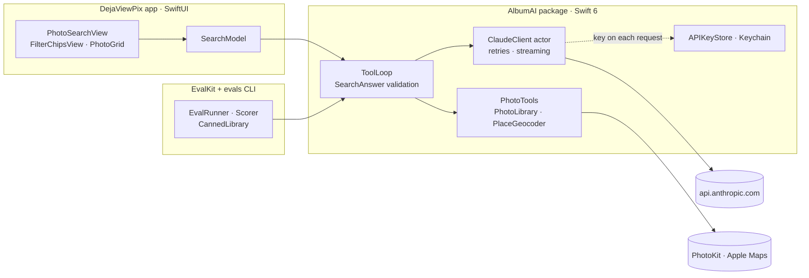

# Deja View Pix

Search your iPhone photo library in plain English: "fotos from whistlr last wintr", "two
Christmases ago", "favorite videos from Tofino last summer". Claude turns the sentence into
searches through tool calling, and the app runs them on the device with PhotoKit.
**No image ever leaves the phone**, only the metadata needed to search.


| | |
|---|---|
| **Accuracy** | 100% exact match on 25 eval cases × 2 runs, 5/5 held-back cases (Claude Haiku 4.5) |
| **Cost** | $0.0067 per search |
| **Speed** | ~6 s to results on an iPhone 13 Pro Max (a named place adds a round: 9–13 s) |
| **Privacy** | Claude sees dates, distances and flags; never images, photo locations or people |

Built in 10 days with SwiftUI and Swift 6, calling the Claude Messages API directly (there's
no official Swift SDK).

## How a search works

```mermaid
sequenceDiagram
    actor User
    participant App as App (SwiftUI)
    participant Loop as ToolLoop (AlbumAI)
    participant Claude as Claude API
    participant Tools as PhotoTools
    participant Device as PhotoKit · Apple Maps

    User->>App: "photos from Whistler last winter"
    App->>Loop: query, today's date, time zone
    Loop->>Claude: system prompt + tools + query
    Claude-->>Loop: geocode_place("Whistler, British Columbia")
    Loop->>Tools: run the tool
    Tools->>Device: Apple Maps lookup
    Tools-->>Loop: coordinates, 15 km radius
    Loop->>Claude: tool_result
    Claude-->>Loop: search_photos(2025-12-01 to 2026-02-28, near Whistler)
    Loop->>Tools: run the tool
    Tools->>Device: PhotoKit fetch
    Tools-->>Loop: p1, p2, p3 with dates and distances
    Loop->>Claude: tool_result
    Claude-->>Loop: present_results(summary, [p1, p2, p3])
    Loop->>Loop: validate: every alias came from a search
    Loop-->>App: summary, real photo IDs, filters rebuilt from the calls
    App-->>User: status lines, then the grid and filter chips
```

1. **Claude only plans the search.** It gets three tools: `geocode_place`, `search_photos`
   (dates, media type, favorites, album, location and radius) and `list_albums`. The app
   runs them and sends back compact JSON.
2. **Claude finishes by calling `present_results`**, a strict tool with a summary and the
   photos to show. The answer is checked before anything is shown: every photo must have
   come from a search that ran. If not, Claude gets one chance to fix it.
3. **The filter chips come from the tool calls that actually ran**, not from Claude's
   description of what it did. Each chip can be removed or changed (dates, radius, photos ↔
   videos), and the edit re-runs on the device with no model call: 30 ms, no cost.
4. **Status lines** ("Finding Whistler…", "Searching photos from December 2025–February 2026
   near Whistler…") are built from each tool call's input as it starts.

### Code layout



- **`AlbumAI/`**: everything that isn't a view. The Messages API types, `ClaudeClient` (an
  actor), the tool loop and its validation, PhotoKit search, geocoding, pricing, failure
  mapping. Tested without a simulator: 121 tests, offline, in under a second.
- **`DejaViewPix/`**: the SwiftUI app. Search, a Chat tab (streaming text, from the first
  days of the build) and an API Key tab.
- **`AlbumAI/Sources/EvalKit` and `evals`**: the eval runner. It drives the real tool loop
  and the real API against a canned photo library.

## Privacy

The app shows this note from the search screen (the hand icon).

**Sent to Claude during a search**
- The query, today's date and the time zone.
- For each matching photo: a short alias (`p1`, `p2`, …), the date and time it was taken,
  its distance from the place searched for, and whether it's a video or a favorite.
- Album names and counts, when the search involves an album.
- Names and coordinates of places the user names, looked up with Apple Maps.

**Never sent**
- Images or anything derived from them: faces, people, captions, contents.
- Where photos were taken. Coordinates stay on the device; only the distance to the
  searched place is shared.

**The API key** is stored in the Keychain, on this device only
(`kSecAttrAccessibleWhenUnlockedThisDeviceOnly`): never in source code, `Info.plist`, build
settings or logs. The client reads it for each request instead of keeping it in memory.
This is a development setup: a public release would send requests through a backend that
holds the key and adds user authentication and rate limits.

Why metadata only: the model's job is to understand the sentence, and for that it needs to
know what the photos are *about* only in terms the search can filter on. Sending images would
add cost and latency and would put the most sensitive data in the library on the network,
for no gain in finding "last winter in Whistler".

## Run it

**Requirements:** Xcode 26 or later, iOS 17.5 or later, and a Claude API key from the
Claude Console.

1. Open `DejaViewPix.xcodeproj` and run the `DejaViewPix` scheme on a simulator or an iPhone.
2. In the app, open the **API Key** tab, paste your key and tap **Save**.
3. On the **Search** tab, allow photo access and try "photos from last summer".

**An empty simulator?** Seed it with 9 photos that have real dates and places (Whistler,
Vancouver, Squamish, Paris, Tofino):

```sh
xcrun simctl boot "iPhone 17"   # or any simulator
swift scripts/seed-simulator-photos.swift
```

**Tests** run on the Mac, with no simulator and no network:

```sh
cd AlbumAI && swift test
```

Debug builds add a ladybug menu to the search screen that makes the next search fail in a
chosen way (offline, bad key, 429, 529 overload, endless tool calls), to check every failure
path without breaking the network.

## Evals

The model's only job is to turn a sentence into `search_photos` arguments. PhotoKit and the
geocoder are deterministic and unit-tested, so the evals score **the arguments of Claude's
first valid search** against answers written by hand before any run, field by field: dates,
place, media type, favorites, album. A case passes only when every field and the expected
behavior (search, find nothing, or refuse) are right.

- **30 cases:** 25 dev and 5 held back, run once at the end. They cover relative dates
  ("last winter" in both hemispheres, "two Christmases ago"), misspellings, ambiguous places
  (Victoria from Vancouver vs. from Melbourne; Springfield), combined filters, albums,
  impossible requests, an off-topic request and a prompt injection.
- **Rules decided up front:** exact dates (±1 day only for holidays and "last weekend"),
  places compared by coordinates within 25 km, and any filter the user didn't ask for is
  wrong. Details in [`evals/README.md`](evals/README.md).
- **Each case runs twice** through the real loop and API, so flaky cases show up.

```sh
cd AlbumAI
ANTHROPIC_API_KEY=… swift run evals                  # 25 dev cases × 2 runs on Haiku
swift run evals --model sonnet --split all            # another model, held-back cases too
```

### Results

The prompt was improved on Haiku one change at a time, each measured on its own:

| Step | Haiku exact match |
|---|---|
| Baseline prompt | 76% |
| + computed dates of the last completed seasons, both hemispheres | 92% |
| + a named day (Christmas) means that date, not the whole month | 94% |
| + seasons follow the user's hemisphere when no place is named | 96% |
| + no clarifying questions: pick the likely place and say which | 98% |
| Same prompt, with photo aliases (re-run on Day 9) | **100%** |

| Model (final prompt) | Dev (25 × 2) | Held-back (5 × 2) | p95 latency (evals) | Cost per search |
|---|---|---|---|---|
| **Claude Haiku 4.5 (shipped)** | 98–100% | 100% | 4.8 s | $0.0066 |
| Claude Sonnet 5.5 | 100% | 100% | 8.6 s | $0.0156 |

Latency and cost in the model table are from the Day 8 comparison, run back to back. The
Day 9 re-run measured a 7.7 s p95 for Haiku with the same rounds and tokens, so API speed
varies from run to run; the iPhone numbers at the top are measured in the app. The full
history, with every change and its result files, is in [`evals/CHANGELOG.md`](evals/CHANGELOG.md).

## Decisions and trade-offs

- **Haiku over Sonnet.** Both are at or near 100%. Haiku's only miss was one run of
  "photos from Springfield", where neither answer hurts the user. Sonnet costs 2.4× more and
  is about 4 s slower at p95, which users feel on every search. The model is one enum case,
  so a larger eval set that showed a real gap would change the decision with a re-run.
- **Short photo aliases instead of PhotoKit IDs.** Instruments on a real iPhone showed 14–21 s
  searches with the CPU idle. Each PhotoKit identifier
  (`6F9B2C1E-3A4D-4B8E-9C2F-1A2B3C4D5E6F/L0/001`) costs about 30 output tokens, and Claude
  was copying 30 of them into its answer. With `p1`, `p2`, … output fell from ~1,170 to
  ~350 tokens, searches from ~15 s to ~6 s, and cost by 40%. The evals had missed it: their
  canned library uses short IDs.
- **A `present_results` tool instead of free text or native structured output.** The answer
  is a tool call like the searches, so one loop handles everything, and a bad answer is
  corrected through a `tool_result` tied to that call. `strict: true` guarantees its shape;
  validation catches what a schema can't (photos no search returned).
- **The model never has the last word.** Photo IDs are checked against what searches
  returned, filters are rebuilt from the calls that ran, and status lines come from tool
  inputs, not from text the model writes.
- **Edits run locally.** Changing a chip re-runs the filters on the device instead of asking
  Claude again: instant, free, and the user stays in control. Claude's summary is hidden
  after an edit, because it no longer describes what's shown.
- **Retries that can't duplicate.** 429, 5xx and 529 overloads retry up to 3 attempts with
  exponential backoff and jitter, honoring `retry-after`, and the user sees "Claude is busy.
  Retrying in 2 s (attempt 2 of 3)". Streaming retries only before the first event, so text
  is never repeated. Every search has a 60 s limit, and Cancel stops a backoff at once.
- **No SDK.** There's no official Swift SDK, and the API is one HTTP endpoint. The client
  sends `anthropic-version: 2023-06-01` and decodes unknown content blocks without failing.

### Known limits

- Searches that name a place take three model rounds (geocode, search, answer): 9–13 s on
  the iPhone. Prompt caching of the system prompt and tools would cut cost and some latency.
- The API key lives on the device; see [Privacy](#privacy) for the production setup.
- The eval set is small (30 cases), so a single run is worth 2 points; it shows the prompt
  reasons about dates and places, not that every phrasing works.
